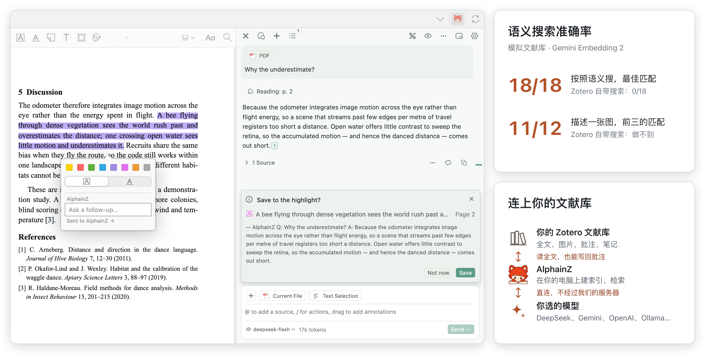

<p align="center">
  <picture>
    <source media="(prefers-color-scheme: dark)" srcset="docs/images/header-zh-dark.svg">
    
  </picture>
</p>

<p align="center">
  <a href="https://github.com/Alphainfix/AlphainZ/releases/latest"></a>
  <a href="https://www.zotero.org"></a>
  <a href="LICENSE"></a>
</p>

<p align="center">
  <a href="https://alphain.app/z/">网站</a> ·
  <a href="https://github.com/Alphainfix/AlphainZ">GitHub</a> ·
  <a href="https://github.com/Alphainfix/AlphainZ/releases/latest">下载</a> ·
  <a href="https://github.com/Alphainfix">作者：Alphainfix</a>
</p>

<p align="center"><a href="README.md">English</a> · <b>简体中文</b></p>

**开源免费，随你定制。** AlphainZ 是装在 Zotero 里的研究助手，用你自己的模型和 API key 对话，不用注册账号。它的部分前端代码 fork 自 Joscha Legewie 的 [Beaver](https://github.com/jlegewie/beaver-zotero)，后端则让你直接和模型厂商对话，中间不经过别人的服务器，方便、安全、[省钱](#成本)。

<p align="center">
  
</p>

## 能做什么

### 问你的整个文献库

AlphainZ 会自己决定怎么找，几种方式一起用：

- **全文向量索引。** 每个 PDF 切成段落做嵌入，可以用云端模型（Gemini Embedding 2、OpenAI），也可以用你电脑上的模型（Ollama 里的 EmbeddingGemma 2）。检索按语义匹配：换个说法、甚至换一种语言问，也能匹配到意思相同的段落。索引在后台自动建，可以关掉。
- **按语义找图。** 嵌入模型也能看图时，每一页还会当成一张图建索引：描述一张图，就能匹配到它在哪一页。
- **识别到句子。** 读每个 PDF 的文字时记下每一句的位置，所以回答能引用到具体的句子，点一下就打开 PDF、跳到那里并高亮。扫描页和图表由能看图的模型直接看页面图片。
- 还有元数据（作者、年份、期刊）、关键词搜索，以及按分类、标签浏览。

### 问你正在读的论文

在 PDF 里选中一段话、一张图或一个表格，直接在弹出框里问；也可以在侧栏里问整篇论文。

### 答案留在高亮里

从选中文字提的问题会锚定到一条高亮上。回答好以后，侧栏底部会出现一张卡片（见开头的截图），点一下就能把问题和答案存进这条高亮的批注：它们留在 PDF 里、跟着 Zotero 同步，点这条高亮就能重新打开那段对话。

### 还有

- **写进 Zotero。** 能在 PDF 里加高亮和批注，也能写笔记、打标签、整理分类；每次写入前都会先问你。
- **找库外的文献。** 通过 OpenAlex 检索文献，把找到的加进某个分类。
- **长对话不贵。** 对话变长时，较早的部分会自动压缩成摘要；每个问题都有输出和步数的上限。
- **多台电脑一起用。** 对话和设置可以通过 Zotero 或你选的文件夹（iCloud Drive、OneDrive 等）同步；API key 只留在填它的那台电脑上。
- **中英文界面。** 界面有英文和简体中文两种：在欢迎页第一页选，或者在 设置 → 常规 → 外观 里改，默认跟随 Zotero 的语言。
- **给其他 AI 工具用。** 在 设置 → 高级 → MCP 服务器 里打开后，AlphainZ 会在 Zotero 数据文件夹里生成一个小桥接文件`alphainz-mcp-stdio.mjs`。在 Claude Desktop 这类客户端里把它加成用 `node` 运行的 stdio 服务器。Zotero 开着时，客户端就能按元数据、主题或全文的意思搜索你的文献库，用文字描述找图，读论文、看页面，读你的笔记、高亮和批注。

## 语义的图片/文字搜索准确度

**模拟文献库。** 6 篇专门写的模拟论文（[`docs/benchmark`](docs/benchmark)）和 36 个问题，直接跑 AlphainZ 的检索，不经过语言模型。按语义搜的问题都刻意不用原文的词，只能靠语义匹配：

| 问题 | AlphainZ +<br>EmbeddingGemma&nbsp;2<br>（本地，免费） | AlphainZ +<br>Gemini&nbsp;Embedding&nbsp;2<br>（用你自己的 API key） | Zotero<br>自带搜索 |
|---|:-:|:-:|:-:|
| 按语义搜：英文提问（12） | 12 个都是最佳匹配 | 12 个都是最佳匹配 | 0 个匹配到 |
| 按语义搜：中文问英文论文（6） | 6 个都是最佳匹配 | 6 个都是最佳匹配 | 0 个匹配到 |
| 描述一张图（12） | 最佳匹配 5 个<br>前三匹配 8 个 | 最佳匹配 6 个<br>前三匹配 11 个 | 做不到 |
| 原文关键词（6） | 5 个最佳匹配¹ | 5 个最佳匹配¹ | 6 个都匹配到 |

¹ 只按语义搜。AlphainZ 也会按关键词搜，第六个就是这样匹配到的。

**真实文献库。** 在一个有 249 个 PDF（18,986 段）的真实研究文献库上，用 15 个按语义搜的问题（8 个英文、7 个中文）测试：答案所在的论文，用 EmbeddingGemma 2 有 12 次是最佳匹配，用 Gemini Embedding 2 有 11 次（平均倒数排名分别是 0.875 和 0.856，越接近 1 说明正确答案越靠前；OpenAI 的 text-embedding-3-large 是 0.813）。用 EmbeddingGemma 2 时，7 个中文问题的最佳匹配全都是对应的英文段落。给这个库建索引，在 MacBook Air 上本地跑不花钱（每秒约 16 段），用 Gemini 约 1 美元。

## 和同类工具比

| | AlphainZ | Beaver | Zotero GPT | PapersGPT |
|---|:-:|:-:|:-:|:-:|
| 在 Zotero 里用你自己的文献库 | ✅ | ✅ | ✅ | ✅ |
| 搜索整个库的全文 | ✅ | ✅¹ | ❌² | ✅ |
| 描述一张图就能匹配到 | ✅ | ❌ | ❌ | ❌ |
| 引用到句子，点开 PDF 就到那里 | ✅ | ✅ | ❌ | 🟡 只到论文 |
| 把高亮和笔记写进 Zotero | ✅ | ✅ | 🟡 仅 Pro | 🟡 仅笔记 |
| 用自己的 API key、任意 OpenAI 兼容接口 | ✅ | ✅ | ✅ | ✅ |
| 通过 Ollama 用本地模型 | ✅ | ❌³ | – | ✅ |
| 不用账号、不用订阅 | ✅ | ❌ | – | – |
| 开源 | ✅ AGPL | ✅ AGPL | 🟡 只有核心⁴ | ✅ AGPL |

✅ 有 · 🟡 部分有 · ❌ 按该产品自己的页面没有 · – 没写。2026 年 10 月下旬根据各项目的 README 和 Zotero 论坛帖核对，有错欢迎指正。<br>
¹ 付费版按语义搜全文；免费版只按语义搜标题和摘要。<br>
² 只能问当前打开的 PDF 或你选中的条目。<br>
³ 请求要经过 Beaver 的服务器。<br>
⁴ 核心代码是 AGPL，Pro 功能不开源。

NotebookLM、ChatPDF 这类通用的「和 PDF 对话」服务，处理的是上传到它们云端的文件，不在 Zotero 里。

## 模型

内置：DeepSeek、OpenRouter、智谱（BigModel）、Google Gemini、OpenAI，以及你电脑上的 Ollama。其他兼容 OpenAI 接口的服务，比如代理、机构网关、本地服务器，都可以手动添加，走 Chat Completions 或 Responses 接口。

每个模型都可以设置：支持哪些思考档位（输入框的 Thinking 菜单就只列这些）、上下文窗口多大（长对话在用到 70% 之前压缩），以及一次回答最多用多少 token。

## 成本

AlphainZ 本身免费，花的只是付给模型厂商的 token 费用。按 62 个真实问题的平均用量（每个问题读约 8 万 token，其中 83% 命中缓存，写约 3 千 token）和官方标价估算：

| 模型 | 每个问题 | 一天狂聊 100 次 |
|---|:-:|:-:|
| DeepSeek V4.1 Flash | 约 $0.004<br>（高峰时段约 $0.008） | 约 $0.4 |
| OpenAI gpt-6-luna | 约 $0.004 | 约 $0.4 |

也就是说，一天高强度狂聊 100 次，成本也就 0.4 美元左右，不到 3 块钱。用 Ollama 跑本地模型完全免费。给文献库建语义索引另算：用本地的 EmbeddingGemma 2 免费，用 Gemini Embedding 2 大约每 250 篇论文 1 美元。

价格是 2026 年 10 月底的官方标价。DeepSeek 在工作日北京时间 9–12 点和 14–18 点按高峰价收费，贵一倍。

## 安装

1. 从[最新版本](https://github.com/Alphainfix/AlphainZ/releases/latest)下载 `.xpi` 文件。
2. 在 Zotero 7 或更新版本里：工具 → 插件 → 右上角齿轮 → Install Plugin From File…，选这个文件。
3. 点工具栏上的 AlphainZ 按钮打开，然后 设置 → 模型 → 添加服务商：贴上 key，选一个模型。

之后 Zotero 会自己从这个仓库检查新版本。

## 隐私

- 你的问题和需要用到的论文内容，从你的电脑直接发给你选的模型服务商。没有 AlphainZ 的服务器。
- API key 和 Zotero 的其他设置一样，以明文存在填它的那台电脑的 `prefs.js` 里。
- 检索索引、对话和缓存都在你 Zotero 数据文件夹的 `alphainz.sqlite` 里。
- 文献检索只把检索词（以及你填的 OpenAlex key，如果有）发给 OpenAlex。

## 从源码构建

```bash
git clone https://github.com/Alphainfix/AlphainZ.git
cd AlphainZ/plugin
npm install
cp .env.production.example .env.production
npm run build        # 生成 .scaffold/build/alphain-z.xpi
npm test
```

`.env.production` 里的值只是占位：从 Beaver 继承来的一个组件仍会创建一个用不到的客户端，没有这些值就加载不了。

## 更新记录

- **0.1.80**（2026-11-25）：中文界面；MCP 多了 8 个读库工具（按意思搜全文、找图、看页面和图片、读高亮和批注）。
- **0.1.78**（2026-10-30）：第一个公开版。

每一版的完整说明见[发布页](https://github.com/Alphainfix/AlphainZ/releases)。

## 许可证

AlphainZ 是自由软件，和它所基于的 Beaver 一样，使用 [GNU Affero 通用公共许可证 v3.0 或更新版本](LICENSE)。截图和测试集用的都是为这个仓库写的模拟论文。

- [Beaver](https://github.com/jlegewie/beaver-zotero)，Joscha Legewie：原始插件。
- [MuPDF](https://mupdf.com)，Artifex：PDF 文字和渲染（AGPL-3.0）。
- [sentencex](https://github.com/wikimedia/sentencex)，Santhosh Thottingal：分句（MIT）。
- [Zotero Plugin Template](https://github.com/windingwind/zotero-plugin-template)：构建脚手架。

对比表来源：[Beaver](https://github.com/jlegewie/beaver-zotero) 及其[论坛帖](https://forums.zotero.org/discussion/126573/)、[Zotero GPT](https://github.com/MuiseDestiny/zotero-gpt)、[PapersGPT](https://github.com/papersgpt/papersgpt-for-zotero)。
